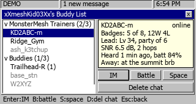
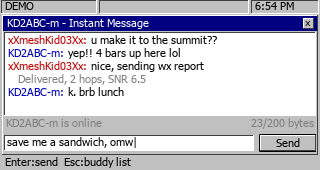
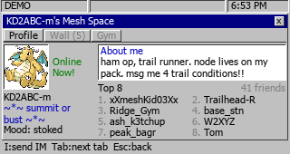
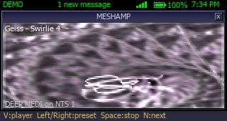
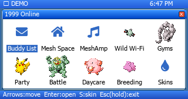
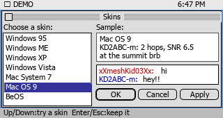

# 1999 Online

A retro Meshtastic messenger for the M5Stack **Cardputer Zero**, dressed up as
the internet of 1999: an AIM-style Buddy List and Instant Message windows, a
MySpace-style **Mesh Space** profile page, **MeshAmp** (a Winamp-style player
with a MilkDrop-style visualizer), swappable desktop skins (Windows 95/ME/XP,
Mac OS 9, System 7, BeOS, OS/2, X11, Winamp), and **MonsterMesh**, a
monster-breeding and gym-battle game played over the mesh.

It is a native C++17 / LVGL 9 app for the Cardputer Zero (Pi CM0, aarch64,
1.9" 320x170 screen, 46-key keyboard). It also runs as an SDL desktop
simulator on macOS and Linux.

| | | |
|---|---|---|
|  |  |  |
|  |  |  |

> **Status:** work in progress. The UI is changing quickly.

## Install on the Cardputer Zero

1. Download `1999Online_0.1.0_rev1_arm64.deb` from the
   [latest release](https://github.com/GoatsAndMonkeys/1999-online/releases/latest).
2. Copy it to the device:

   ```bash
   scp 1999Online_0.1.0_rev1_arm64.deb <user>@cardputerzero.local:/tmp/
   ```

3. On the device, install it:

   ```bash
   sudo apt install /tmp/1999Online_0.1.0_rev1_arm64.deb
   ```

   To update an installed copy to a new build of the same version, add
   `--reinstall`.
4. Open **1999 Online** from the launcher.

To connect it to a Meshtastic radio, see [Connecting a radio](#connecting-a-radio).
To build it yourself, read on.

## Dependency: the MonsterMesh game engine

The battle engine, Gen 1–3 data, breeding genetics, gym logic and sprite data
are not in this repository. They are compiled, read-only, from the
[MonsterMesh](https://github.com/GoatsAndMonkeys/monster_mesh) project
(`monster_mesh_pi/` on the `mm/monster-mesh-pi` branch). By default the build
looks for it next to this checkout:

```
projects/
  pocket-computer-1999/      <- this repo
  pokemesh/                  <- git clone -b mm/monster-mesh-pi https://github.com/GoatsAndMonkeys/monster_mesh.git pokemesh
    monster_mesh_pi/
```

To put it somewhere else, pass `-DMM_ROOT=/path/to/monster_mesh_pi` to CMake,
or set `MM_ROOT=/path/to/monster_mesh_pi` for `scripts/build-deb.sh`.

## Build: desktop simulator (macOS / Linux)

Needs CMake ≥ 3.31, Ninja, SDL2, libpng, freetype and fmt
(`brew install cmake ninja sdl2 libpng freetype fmt`).

```bash
cmake --preset darwin-arm64            # or linux-x86-64
cmake --build build/darwin-arm64 --config Debug
./build/darwin-arm64/Debug/monstermesh --demo
```

Flags:

* `--demo`: demo data, no radio and no game daemon.
* `--screen <slug>`: open one screen directly.
* `--skin <name>`: start with a given skin.
* `--shots <dir> [--screen <slug>]`: render the screens headlessly to 320x170
  PNGs, then exit.
* `--icon <file.png> <size>`: render the launcher icon.

## Build: arm64 .deb for the device

```bash
scripts/build-deb.sh                   # -> dist/1999Online_0.1.0_rev1_arm64.deb
```

The script cross-builds inside a `linux/arm64` Debian trixie container (Docker;
native on Apple Silicon, qemu/binfmt on x86_64). The CM0 BSP (about 430 MB) and
fetched dependencies are cached in `~/.cache/monstermesh-cp0` (`MM_CP0_CACHE`).
On a Linux host with `aarch64-linux-gnu-gcc` 14 you can skip Docker:
`cmake --workflow --preset cp0-cross-package`.

Install on the device with `sudo apt install ./1999Online_*.deb`. It installs
`/usr/bin/1999online`, its config and the launcher entry and icons under
`/usr/share/APPLaunch/`.

## Connecting a radio

The messenger talks to a Meshtastic node through Meshtastic's client API.
Without a radio it runs on demo data and the status strip says `DEMO`.

| Where the radio is | Setting |
|---|---|
| `meshtasticd` on the device (LoRa add-on), TCP port 4403 | nothing: `tcp:localhost:4403` is the default on Linux |
| a node on the network | `PC1999_MESH=tcp:<host>[:port]` |
| a node on USB | `PC1999_MESH=serial:/dev/ttyACM0` (macOS: `serial:/dev/cu.usbmodem…`) |
| no radio | `PC1999_MESH=off` (the default on macOS) |

The value can also go in `settings.json` as `mesh.target`. A message is at most
200 bytes (one packet). `tools/fake_meshtasticd.py` is a stand-in node for
tests (`tests/backend/mesh_backend_live_test.cpp`).

## Keys

| Key | Action |
|---|---|
| Arrows, or `;` `.` `,` `/` | Move |
| Enter / Space | Select / confirm |
| Esc / Backspace / `` ` `` | Back (hold Esc on the home screen to exit) |
| Tab | Switch tab / pane |
| Letters / digits | Screen shortcuts, shown in the footer |
| PrintScreen | Screenshot |

## Saved settings

Settings, conversations and your Mesh Space page are small JSON files in
`$PC1999_CONFIG_DIR`, else `$XDG_CONFIG_HOME/1999online`, else
`~/.config/1999online`. Delete a file to go back to the defaults.

## Layout

| Path | What |
|---|---|
| `src/core/` | Application startup, screen router, key handling |
| `src/ui/` | Skins, widgets, the visualizer |
| `src/screens/` | One file per screen (buddy list, IM, Mesh Space, MeshAmp, radio, skins, MonsterMesh screens) |
| `src/backend/` | Meshtastic link, messenger model, settings, game state |
| `src/sprites/` | Monster sprites → LVGL images |
| `src/app, platform, view, logger, config` | Infrastructure adapted from [CardputerZero/Template](https://github.com/CardputerZero/Template) |
| `tests/`, `tools/` | Backend tests and test tools |
| `docker/`, `scripts/`, `cmake/` | Device build and packaging |

## MilkDrop presets

MeshAmp can play the original MilkDrop preset pack. It has no licence
statement, so it is not stored here: `scripts/fetch_milkdrop_presets.sh`
downloads it from the projectM project into `assets/milkdrop/pack/`.

## Licence and credits

1999 Online is released under the GNU General Public License v3.0 (see
`LICENSE`), the same licence as the MonsterMesh engine it is built with.

* Build plumbing from [CardputerZero/Template](https://github.com/CardputerZero/Template), MIT (`third_party/CardputerZero-Template-LICENSE`).
* Fonts: Phosphor Icons (MIT) and Kenney Input Prompts (CC0); see `assets/fonts/LICENSE.txt`.

**Disclaimer.** MonsterMesh is an unofficial, non-commercial fan project. It is
not affiliated with, endorsed by or sponsored by Nintendo, Game Freak, Creatures
Inc. or The Pokémon Company. Pokémon and related names and characters are
trademarks of their respective owners.
